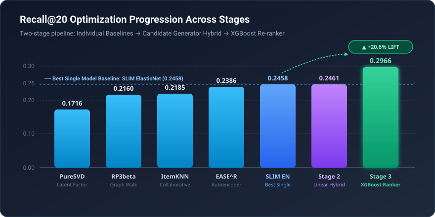

# Two-Stage Hybrid Recommender System for Recall@20 Optimization

This repository implements a two-stage hybrid recommender system developed for the Recommender Systems challenge at Politecnico di Milano (A.Y. 2025/2026). The goal was to maximize **Recall@20** for top-N movie recommendation with implicit user feedback.

The dataset consisted of:

- **~3.8M interactions**
- **~27k users** and **~7k items** (sparse user-item matrix)
- **80/20 random holdout** evaluation
- **Metric**: Recall@20

---

## Overview

- **Final Result**: **Rank #15** on the private leaderboard (`0.52112`, within ~1% of 1st place) out of a total of 71 teams

The solution employs a three-stage pipeline:

1. **Base Model Training & Hyperparameter Tuning**: Individual optimization of 13+ collaborative, graph, linear, and neural models via Optuna.
2. **Candidate Generation**: Weighted linear combination of top-performing models optimized for high-coverage candidate retrieval (top-50 cutoff).
3. **Learning-to-Rank Re-ranking**: High-dimensional feature engineering and gradient boosted ranking using **XGBoost Ranker** (`rank:map`).

---


### Stage 1: Base Models & Hyperparameter Tuning

Base algorithms were trained and hyperparameter-tuned with Optuna using Bayesian optimization:

- **Collaborative Filtering**: ItemKNN, UserKNN
- **Graph-Based**: RP3beta, P3alpha, TWRA (Two-Way Random Walk / Rank Aggregation), HHP, LightGCN
- **Linear Models & Autoencoders**: SLIM ElasticNet, EASE^R
- **Matrix Factorization & Neural**: IALS, PureSVD, Scaled PureSVD, LightFM, MultVAE (PyTorch)

Models were tuned at two distinct cutoffs:

- **Recall@50**: Maximizing candidate retrieval coverage for Stage 2 (SLIM ElasticNet: `0.4489`, EASE^R: `0.4402`, TWRA: `0.4291`, IALS: `0.4110`).
- **Recall@20**: Providing optimal normalized score features for Stage 3.

---


### Stage 2: Candidate Generator

To feed the re-ranker, a pool of **50 candidate items per user** is generated via a weighted linear combination of top-performing models:

$$
\text{score}(u, i) = \sum_{k} w_k \times \hat{r}_k(u, i)
$$

The weights $w_k$ were optimized via Optuna on the validation set:

- Primary weights: **SLIM ElasticNet** (0.854), **UserKNN** (0.345), **EASE^R** (0.218), **IALS** (0.217), **RP3beta** (0.083), **ItemKNN** (0.005).

---


### Stage 3: XGBoost Re-ranker

Candidate pools are re-ranked to produce the final **top-20 recommendations** using `XGBRanker`.

#### Feature Engineering

- **Base Model Scores & Ranks**: $L_\infty$-normalized prediction scores, dense rank positions, and binary top-20 indicators across all base recommenders.
- **Ensemble Consensus**: Total count of models recommending the item in top-20 (`Counter_Recommended`), min/mean/std rank positions.
- **Graph Similarity Distributions**: Mean, max, min, std, skewness, and kurtosis of candidate items against the user's past interactions using ItemKNN and RP3beta similarity matrices.
- **Popularity & Diversity Metrics**: Normalized user profile length, item popularity, user mainstreamness affinity, item Gini index, and Shannon entropy over interacting user profiles.
- **Latent Factor Interactions**: Low-rank user and item latent factor interactions with model scores and profile lengths.
- **Overfitting Prevention**: Raw categorical `UserID` and `ItemID` are omitted to avoid memorization and ensure generalized ranking rules across unseen users.

---


## Tuning Methodology & GitHub MLOps

Hyperparameter optimization was executed remotely on Kaggle GPU/CPU instances and synchronized continuously via GitHub:

- **Optuna SQLite Persistence**: Every study was logged into SQLite databases (`*.db`) in `tuning_results/`.
- **Automated Git State Sync**: Kaggle tuning notebooks integrated `PyGithub` to commit updated `.db` files and `best_params.json` directly back to GitHub after batches of trials.
- **Distributed & Resumable Search**: Enabled pausing, resuming, and running parallel tuning sessions across multiple models without losing trial history.

---


## Results

Progressive performance improvement through the ensemble methodology:


| Stage / Model                  | Validation Recall@20       | Hit Rate@20 | MAP@20     | NDCG@20    |
| ------------------------------ | -------------------------- | ----------- | ---------- | ---------- |
| ItemKNN                        | 0.2185                     | 0.7315      | 0.1013     | 0.1894     |
| RP3beta                        | 0.2160                     | 0.7153      | 0.0979     | 0.1863     |
| EASE^R                         | 0.2386                     | 0.7737      | 0.1106     | 0.2036     |
| SLIM ElasticNet                | 0.2458                     | 0.7972      | 0.1154     | 0.2106     |
| **Stage 2: Linear Hybrid**     | **0.2461**                 | **0.7950**  | **0.1152** | **0.2105** |
| **Stage 3: XGBoost Re-ranker** | **0.2917** *(peak 0.2966)* | **0.9714**  | **0.1516** | **0.2543** |


### Performance Progression



> **Key Takeaway**: The two-stage architecture achieved a **+20.6% relative lift in Recall@20** (reaching **0.2966**) and a **97.14% Hit Rate** over the strongest single model baseline (`SLIM ElasticNet` at 0.2458).


#### Feature Behavior Insights (Gain vs. Weight)

While high-level binary indicators (`SlimElastic_Recommended`) naturally drive maximum loss reduction per split at tree roots (high **Gain**), continuous features (`mainstream_user`, `IALS_Score`, `Hybrid_Score`, and latent interaction cross-products) dominate split frequency with >30,000 splits each (high **Weight**), executing fine-grained candidate re-ranking. Full diagnostic plots for Gain, Cover, and Weight are available in `[assets/](assets/)`.

---


## Repository Structure

```
RecSys_challenge_25/
├── challenge_notebooks/
│   ├── final_xgboost_sumbission/       # Final production pipelines
│   │   ├── xgboostv12.ipynb            # ★ Best final pipeline (Candidate generator + XGBRanker)
│   │   ├── xgboostv11.ipynb            # Previous iteration pipeline
│   │   └── xgboostv7-no-userid-itemid.ipynb # Leakage-prevention ablation
│   │
│   └── tuning/                         # Optuna tuning notebooks (run on Kaggle)
│       ├── Recall@20/                  # Single-model tuning targeting top-20 ranking
│       │   ├── slimen-tuning-r20.ipynb
│       │   ├── ease-r-tuning-r20.ipynb
│       │   ├── rp3beta-tuning-r20.ipynb
│       │   └── ...
│       └── Recall@50/                  # Candidate generator tuning targeting top-50 recall
│           ├── slimen-tuning-r50.ipynb
│           ├── ease-r-finetuning-r50.ipynb
│           └── ...
│
├── tuning_results/                     # Optuna study databases & best params
│   ├── recall@20/                      # SQLite .db files and best_params/*.json
│   ├── recall@50/                      # SQLite .db files and best_params/*.json
│   └── xgboost/                        # XGBoost reranker .db files and best_params/*.json
│
├── models/                             # Pretrained model weights and candidate caches
│   ├── recall@20/
│   └── recall@50/
│
├── assets/                             # Feature importance plots (Gain, Cover, Weight)
├── Recommenders/                       # Core recommendation algorithms (Cython-accelerated)
├── Data_manager/                       # Data splitters and sparse matrix utilities
├── Evaluation/                         # Evaluation metrics (Recall, NDCG, MAP, MRR)
└── run_compile_all_cython.py           # Cython compilation script
```

---

